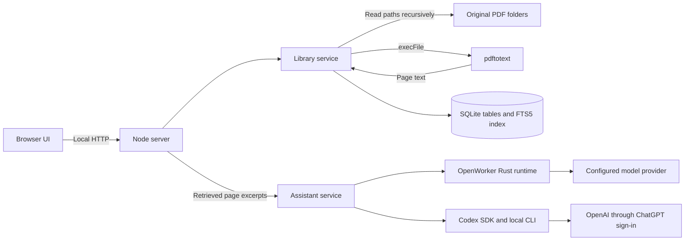

# System architecture

Papertrail has a single-user browser version and a Linux desktop preview sharing the same library/API modules. A Node.js process (Electron main in the desktop app) serves the interface, HTTP API and SQLite database. Poppler extracts PDF text in a child process. The optional assistant selects managed OpenWorker sessions or a local Codex SDK/CLI using ChatGPT sign-in. The browser defaults to OpenWorker; the desktop defaults to Codex and provides graphical setup.

## Source ownership

| Component | Source | Responsibility |
| --- | --- | --- |
| Server | [src/server.js](../../src/server.js) | Startup, configuration, HTTP guards, routes, PDF delivery, shutdown |
| Library | [src/library.js](../../src/library.js) | Schema migration, discovery, extraction, transactions, search, statistics |
| Search helpers | [src/search.js](../../src/search.js) | Option validation, tokenization and one-edit spelling comparison |
| Metadata helpers | [src/metadata.js](../../src/metadata.js) | Best-effort author and abstract extraction from opening pages |
| Title extraction | [src/titles.js](../../src/titles.js) | Verified PDF title metadata, page-layout detection and text fallback |
| Assistant | [src/assistant.js](../../src/assistant.js) | Provider registration, immutable agent registration, sessions, streaming, cancellation |
| Backend selection | [src/assistant-service.js](../../src/assistant-service.js) | Defaults, backend status, global busy coordination and shutdown |
| Codex adapter | [src/codex-assistant.js](../../src/codex-assistant.js) | Local ChatGPT login check, SDK streaming, restrictions, timeout and cancellation |
| Browser | [public/app.js](../../public/app.js) | Fetching, search debounce, cards, dialogs, progress, streamed answers |
| Result highlighting | [public/highlight.js](../../public/highlight.js) | Safe text/mark rendering of server-provided title and excerpt ranges |
| Presentation | [public/index.html](../../public/index.html), [public/style.css](../../public/style.css) | Layout, responsive styling, search explanations |
| Regression suite | [test/library.test.js](../../test/library.test.js) | Generated PDFs, library integration, request handlers, assistant fixtures, migrations |
| Highlight regression suite | [test/highlight.test.js](../../test/highlight.test.js) | Matching semantics, Unicode offsets, snippet boundaries and safe DOM rendering contract |
| Codex regression suite | [test/codex-assistant.test.js](../../test/codex-assistant.test.js) | Actual SDK subprocess fixtures, authentication rules and backend routing |
| Desktop shell | [desktop/main.cjs](../../desktop/main.cjs), [desktop/preload.cjs](../../desktop/preload.cjs) | Window lifecycle, native controls and a narrow isolated IPC bridge |
| Optional AI components | [desktop/tools.js](../../desktop/tools.js) | Detect existing Codex, verify/install user-requested downloads and report unavailable backends |
| Desktop regression suite | [test/desktop.test.js](../../test/desktop.test.js) | Settings/keyring contract, structured login, preferences, database snapshots and trust boundaries |

## Lifetimes and storage

`npm start` loads `.env` if present, resolves the data directory, opens `library.sqlite`, runs any required schema/index migration, and binds to `127.0.0.1`. The default port is 3210. There is no frontend build step or browser framework.

Original PDFs stay in their folders. SQLite holds metadata, extracted page text, and a derived search index. Import progress is an in-memory object and disappears on restart; completed paper transactions persist. There is one import job and at most one assistant answer at a time. SQL executes synchronously in Node; PDF extraction is asynchronous and sequential across files.

The [desktop app](desktop.md) starts that server privately on an ephemeral port, with a per-launch request token injected by its Electron session. Its data is in Electron's user-data directory rather than the source checkout. It owns an independent Codex login home, persistent preferences and encrypted/session-only provider settings. Native AI tools are optional: it detects an existing matching Codex or downloads pinned components from Settings; offline startup/search work without either backend.

OpenWorker starts lazily on the first OpenWorker question. Its durable sessions are separate from SQLite and live under `data/harness/`. Codex login status is checked through the CLI, cached for 30 seconds, and refreshed explicitly on demand. Each Codex question starts a fresh SDK thread in a temporary working directory; Codex itself may retain session history in its own home. The app cancels imports and both engines during shutdown and gives cleanup eight seconds before forced exit.

## Trust boundaries

The server checks Host and supplied Origin headers and binds only to loopback. Browser code never receives model credentials. PDF and model text are rendered using DOM text nodes or `textContent`; they are not inserted as executable HTML. The server serves PDFs only through indexed paper IDs and verifies that resolved paths remain within their recorded roots.

The Node process and its application callbacks have the user's filesystem privileges. Real-path checks and skipped symlinks are application-level restrictions, not an operating-system sandbox. OpenWorker runs with `sandbox: 'off'` and no tools for this assistant. The [Codex adapter](codex.md) requests read-only/tool restrictions and passes only an allowlisted environment, with ChatGPT-only authentication and no copied API credentials. Its model inference is remote even though the CLI is local. This implementation has no multi-user authentication or network deployment configuration.
