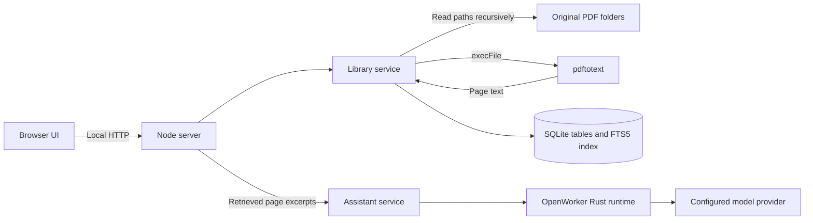

# System architecture

Papertrail is a single-user local web app. A Node.js process serves static browser assets, an HTTP API, and a SQLite database. Poppler extracts PDF text in a child process. An optional managed OpenWorker Rust subprocess runs model sessions.

## Source ownership

| Component | Source | Responsibility |
| --- | --- | --- |
| Server | [src/server.js](../../src/server.js) | Startup, configuration, HTTP guards, routes, PDF delivery, shutdown |
| Library | [src/library.js](../../src/library.js) | Schema migration, discovery, extraction, transactions, search, statistics |
| Search helpers | [src/search.js](../../src/search.js) | Option validation, tokenization and one-edit spelling comparison |
| Metadata helpers | [src/metadata.js](../../src/metadata.js) | Best-effort author and abstract extraction from opening pages |
| Assistant | [src/assistant.js](../../src/assistant.js) | Provider registration, immutable agent registration, sessions, streaming, cancellation |
| Browser | [public/app.js](../../public/app.js) | Fetching, search debounce, cards, dialogs, progress, streamed answers |
| Result highlighting | [public/highlight.js](../../public/highlight.js) | Safe text/mark rendering of server-provided title and excerpt ranges |
| Presentation | [public/index.html](../../public/index.html), [public/style.css](../../public/style.css) | Layout, responsive styling, search explanations |
| Regression suite | [test/library.test.js](../../test/library.test.js) | Generated PDFs, library integration, request handlers, assistant fixtures, migrations |
| Highlight regression suite | [test/highlight.test.js](../../test/highlight.test.js) | Matching semantics, Unicode offsets, snippet boundaries and safe DOM rendering contract |

## Lifetimes and storage

`npm start` loads `.env` if present, resolves the data directory, opens `library.sqlite`, runs any required schema/index migration, and binds to `127.0.0.1`. The default port is 3210. There is no frontend build step or browser framework.

Original PDFs stay in their folders. SQLite holds metadata, extracted page text, and a derived search index. Import progress is an in-memory object and disappears on restart; completed paper transactions persist. There is one import job and at most one assistant answer at a time. SQL executes synchronously in Node; PDF extraction is asynchronous and sequential across files.

OpenWorker starts lazily on the first AI request. Its durable sessions are separate from SQLite and live under `data/harness/`. The app cancels imports and AI work during shutdown and gives cleanup eight seconds before forced exit.

## Trust boundaries

The server checks Host and supplied Origin headers and binds only to loopback. Browser code never receives model credentials. PDF and model text are rendered using DOM text nodes or `textContent`; they are not inserted as executable HTML. The server serves PDFs only through indexed paper IDs and verifies that resolved paths remain within their recorded roots.

The Node process and its application callbacks have the user's filesystem privileges. Real-path checks and skipped symlinks are application-level restrictions, not an operating-system sandbox. OpenWorker runs with `sandbox: 'off'` and no tools for this assistant. This implementation has no multi-user authentication or network deployment configuration.
