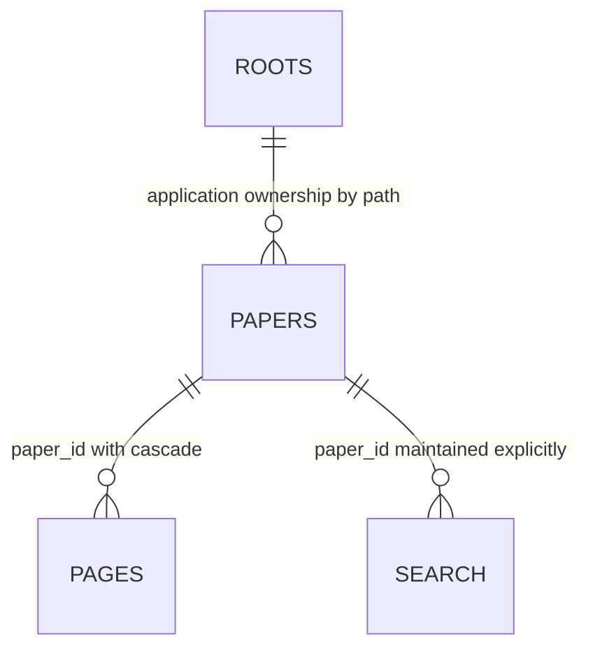

# Database reference

Implementation: the `Library` constructor and migration in [src/library.js](../../src/library.js). Database: `<DATA_DIR>/library.sqlite`. SQLite is accessed through Node's built-in `node:sqlite` `DatabaseSync`; there is no database server or ORM. Startup enables WAL mode and foreign-key enforcement.

## Tables

| Table | Columns | Purpose |
| --- | --- | --- |
| `roots` | `path TEXT PRIMARY KEY` | Canonical imported folder paths |
| `papers` | `id INTEGER PRIMARY KEY`, unique non-null `path`, `root`, `title`, `mtime REAL`, `size INTEGER`, `pages INTEGER`, `status`, nullable `error`, `indexed TEXT DEFAULT CURRENT_TIMESTAMP` | One record per absolute PDF path |
| `pages` | `id INTEGER PRIMARY KEY`, `paper_id` foreign key, `number INTEGER`, `text TEXT` | Extracted text at each one-based PDF page position |
| `search` | FTS5: indexed `title`, indexed `text`, unindexed `paper_id`, unindexed `page`, indexed `abstract`, indexed `authors` | Derived inverted index for retrieval, rank and snippets |
| `search_vocab` | `fts5vocab(search,'col')`: `term`, `col`, `doc`, `cnt` | Vocabulary view used for field-specific fuzzy expansion |

Version 2 adds these non-null `papers` columns: `abstract TEXT DEFAULT ''`, `authors TEXT DEFAULT ''`, `abstract_page INTEGER DEFAULT 1`, `authors_page INTEGER DEFAULT 1`, and `metadata_edited INTEGER DEFAULT 0`. Page fields record where inferred metadata came from. Saving either metadata field sets the shared edit flag; later rescans preserve both fields and clamp their page positions to the new PDF page count. Text may be incomplete or user-corrected and is not verified bibliographic data.

Version 3 adds `title_source TEXT DEFAULT 'legacy'`, `title_page INTEGER DEFAULT 1`, and `title_version INTEGER DEFAULT 0`. A completed title pass sets parser version 1 and provenance to `pdf-metadata`, `pdf-layout`, `pdf-text` or `unavailable`. A saved title correction uses source `manual`. These values are separate from the shared author/abstract edit flag. Legacy title values remain until a rescan, so migration itself does not require original PDFs to be present.

`papers.root` is the importing root path but has no SQL foreign-key constraint. `pages.paper_id` references `papers.id ON DELETE CASCADE`. FTS rows have no automatic foreign-key cascade or update trigger: the library explicitly maintains them in the same transactions as metadata/pages.

`mtime` holds the filesystem modification timestamp in milliseconds; `size` is bytes. `indexed` records SQL UTC time on insert or a processed upsert, not every unchanged rescan. A `ready` paper can contain individual empty pages. `no-text` and `error` records can still be found through their titles.



## How the inverted index works

FTS5 tokenizes titles and page text and maintains token-to-row postings internally. A whole-word query selects matching page rows through `search MATCH ?`. BM25 ranks these rows; the app returns one best page per paper. The index duplicates text already stored in `pages`, which makes it rebuildable without reading the PDFs. Title text is repeated for every indexed page, affecting ranking and storage size.

The application does not maintain an embedding table, content hashes, structured author entities, DOIs, tags, or publication-year fields. SQLite FTS shadow tables are internal implementation details and should not be edited directly.

## Versions and transactions

| `PRAGMA user_version` | Search behavior |
| --- | --- |
| `0` | Legacy/unversioned database; original index used Porter stemming |
| `1` | Earlier literal Unicode index without metadata fields |
| `2` | Author/abstract fields, expanded FTS columns and vocabulary view |
| `3` | Current schema: PDF title provenance, source page and parser version |

Fresh databases and older versions migrate transactionally to version 3. For versions below 2, author/abstract fields are backfilled and FTS is rebuilt. Version 2 only needs new title columns; it preserves corrected metadata and page text. Future versions greater than 3 are rejected. A subsequent folder rescan updates legacy titles and FTS without re-extracting unchanged page text. See [search migration](../architecture/search.md#existing-database-migration).

Paper reindexing and removal use separate transactions per paper. A complete import is not one atomic transaction: committed papers remain available if later files fail or an import is cancelled.

## Inspection and backup

To inspect schema and counts with Node:

```bash
node --input-type=module - <<'JS'
import { DatabaseSync } from 'node:sqlite';
const db = new DatabaseSync('data/library.sqlite', { readOnly: true });
console.log(db.prepare('PRAGMA user_version').get());
console.log(db.prepare('SELECT status,count(*) n FROM papers GROUP BY status').all());
console.log(db.prepare('SELECT count(*) n FROM pages').get());
db.close();
JS
```

For a simple consistent filesystem backup, stop the application and copy the entire data directory, including any remaining WAL-related files and optional harness state. The backup does not include PDFs in their original external folders.
